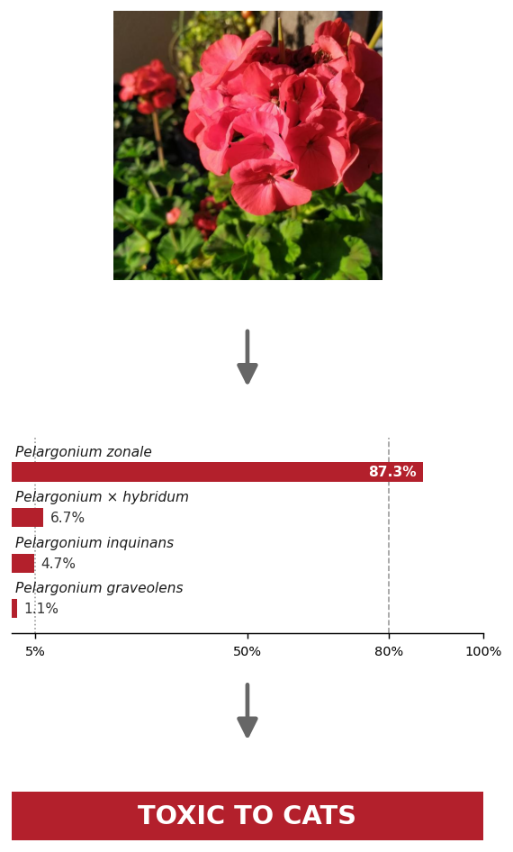
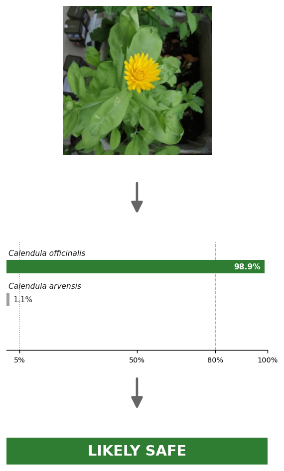
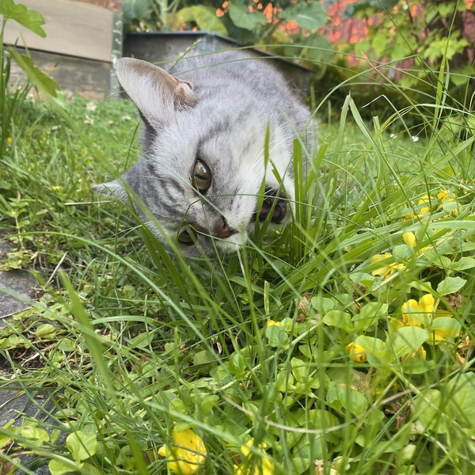
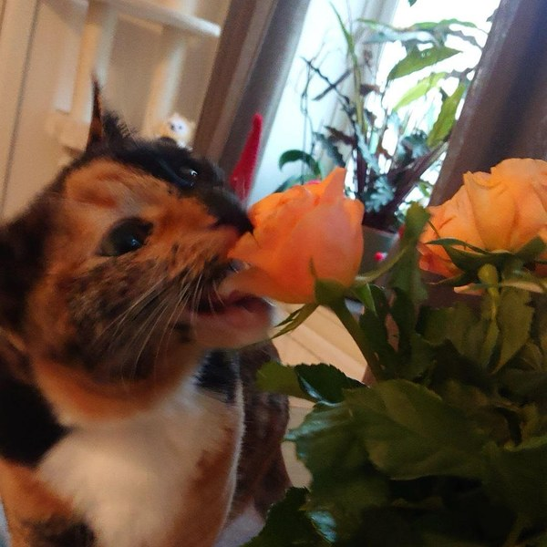
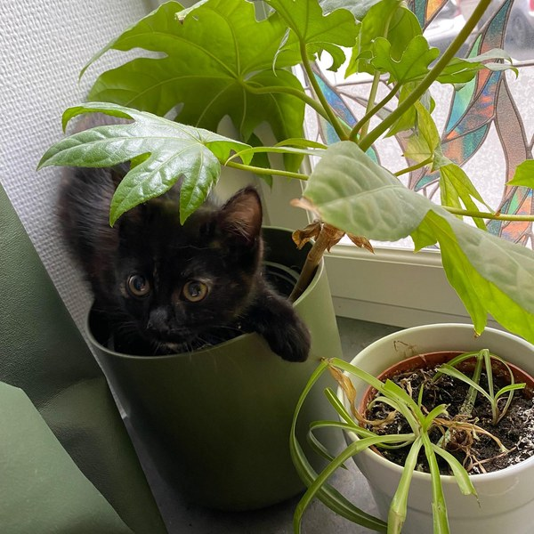
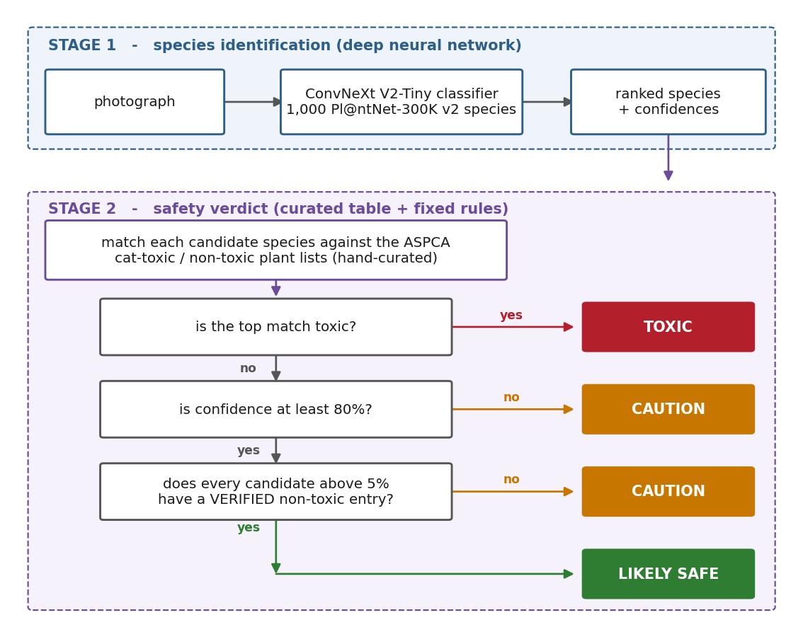
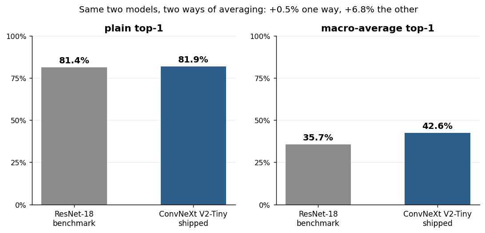
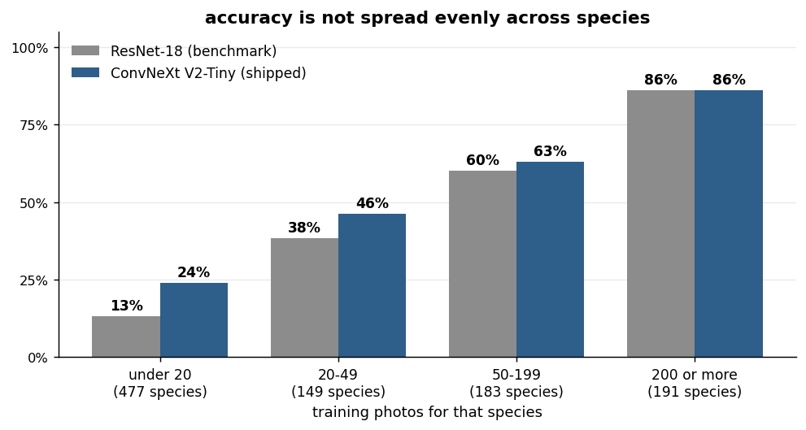

# 🐈 Purr-ceptron

**Find out if a plant is toxic to your cat from a single image.**

[](https://www.python.org/)
[](tests/)
[](#what-this-cant-do)

A lily from a supermarket bouquet can kill a cat that brushes past it and
grooms itself afterwards. A spider plant in the same room is harmless.
Telling them apart means naming the species, which is where most cat owners
stop.

Purr-ceptron names the plant from a photo, checks it against a hand-curated
toxicity table, and returns one of three verdicts:

🔴 **TOXIC**  ·  🟡 **CAUTION**  ·  🟢 **LIKELY SAFE**

> ⚠️ **A proof-of-concept, not a veterinary tool.** It is wrong often enough
> that you should never decide anything about your cat from its output. See
> [What this can't do](#what-this-cant-do).

---

## See it work

Two photos from the held-out test split, read top to bottom: the photograph,
what the classifier made of it, the verdict. Bar length is confidence. Bar
colour is what the table says, which the model had no part in deciding.

<!-- Regenerate with: python scripts/make_readme_figures.py -->
| A geranium | A pot marigold |
|---|---|
|  |  |

On the left every runner-up is another *Pelargonium*, a genus ASPCA lists as
toxic, so no route to a non-toxic answer existed. On the right the only real
alternative sits below the 5% floor, which is what lets **LIKELY SAFE** be
earned.

The cards show candidates above 0.1%. The verdict reads all 1,000.

```console
$ python -m plant_toxicity_checker check --image geranium.jpg --top-k 4

TOXIC TO CATS - keep away from cats
Best match: Pelargonium zonale (L.) L'Hér. (87.3%)
- Best match 'Pelargonium zonale (L.) L'Hér.' is in a genus ASPCA lists as toxic to cats.
Top candidates:
   87.3%  Pelargonium zonale (L.) L'Hér.: TOXIC to cats (whole genus listed)
    6.7%  Pelargonium × hybridum (L.) L'Hér.: TOXIC to cats (whole genus listed)
    4.7%  Pelargonium inquinans (L.) L'Hér.: TOXIC to cats (whole genus listed)
    1.1%  Pelargonium graveolens L'Hér.: TOXIC to cats (whole genus listed)
Note: Only the single most prominent plant in the photo was assessed.
```

---

## Why I built this

<!-- Squares generated from data/images/cats/ originals, centre-cropped to
     600x600. Originals are untouched; re-crop if a framing looks off. -->
| Zåfin | Humla | Katla |
|---|---|---|
|  |  |  |

1. **These three.** They chew on plants, and I usually cannot name what they
   are chewing. That makes it hard to look anything up, and harder to know
   what is safe to bring home.
2. **The dataset is hard.** PlantNet-300K is severely imbalanced: a few
   species have thousands of photos, hundreds have barely any. Handling that
   is most of the work here.
3. **Toxicity is in the training, not just the lookup.** The loss penalises
   confusing a toxic species for a non-toxic one more than other mistakes.

---

## How it works

The neural network never decides whether something is toxic. It answers
"what plant is this?" A hand-checked table answers "is that plant dangerous?"

<!-- Regenerate with: python scripts/make_readme_figures.py -->


Stage 1 is the only part that learned anything. What crosses between the two
is a ranked list of species names: no toxicity data reaches the classifier,
no learned parameter reaches the verdict.

A model trained to output "toxic" or "not toxic" directly can be confidently
wrong with nothing to audit. Split, every verdict traces back to a named
species and a cited source.

Three rules follow, all enforced in code and covered by tests:

| Rule | Why |
|---|---|
| Unknown, unverified, or low-confidence becomes **CAUTION**, never SAFE | A false "safe" is the only dangerous error here |
| 🟢 LIKELY SAFE requires *every* plausible candidate to be a **verified** "no" | One toxic look-alike is enough to withhold it |
| Callers can only make the thresholds **stricter**, never looser | Stops a careless integration weakening the rule |

Mistaking a safe plant for a toxic one costs a houseplant. The reverse can
cost a cat.

---

## Results

**ResNet-18, the benchmark.** Follows the
[Pl@ntNet-300K paper](https://openreview.net/forum?id=eLYinD0TtIt)'s recipe:
ImageNet-pretrained, SGD with Nesterov momentum, batch size 32, weight decay
1e-4, resize-256 with a random 224 crop. Retrained here rather than quoted,
because the paper reports on **v1** (1,081 species) and this uses **v2**
(1,000). The paper benchmarks 27 architectures if you want a wider
comparison.

**ConvNeXt V2-Tiny, the shipped model.** A different recipe: AdamW, cosine
schedule with warmup, batch size 16 with gradient accumulation, an
exponential moving average of the weights, square-root frequency sampling for
the imbalance, and a toxicity-aware term in the loss. Not a benchmark entry.

All figures are on the held-out **test** split. **Top-1** is how often the
best guess is right; **top-5** how often the right species is anywhere in the
top five, which matters because the verdict reads the whole list.

| | ResNet-18 (benchmark) | **ConvNeXt V2-Tiny** |
|---|---|---|
| Top-1 | 81.4% | **81.9%** |
| Top-5 | **95.8%** | 95.6% |
| Macro-average top-1 † | 35.7% | **42.6%** |
| Toxic/non-toxic confusion (lower is better) | 0.86% | **0.27%** |

† *top-1 per species, averaged with every species weighted equally rather
than every photo.*

Plain top-1 barely moves, and that is the finding. It is dominated by the few
species holding most of the photographs, so it sits near 81% whatever happens
in the long tail. Macro-average weights every species equally, which is why
the paper recommends it here, and gains **7 points**.

<!-- Regenerate both with: python scripts/make_readme_figures.py -->


Those 7 points are in the rare species:



The confusion rate is how often a toxic species is mistaken for a non-toxic
one. The toxicity-aware term cuts it **68%**, from 0.86% to 0.27%, without
costing accuracy.

Running the finished pipeline over all 31,115 validation photos:

🔴 TOXIC 6.0%  ·  🟡 CAUTION 83.8%  ·  🟢 LIKELY SAFE 10.2%

CAUTION dominates because 726 of the 1,000 species have no toxicity-table
entry, so the system says it does not know rather than guessing. The
bottleneck is data coverage, not model accuracy.

*Derivations and per-species breakdowns:
[`notebooks/02_training.ipynb`](notebooks/02_training.ipynb).*

---

## Try it

```bash
git clone git@github.com:carltoast/purr-ceptron.git && cd purr-ceptron
python -m venv .venv
.venv\Scripts\activate            # Windows  (source .venv/bin/activate elsewhere)
pip install -r requirements.txt && pip install -e .
```

Weights are not in the repo. Download both from the
[latest release](https://github.com/carltoast/purr-ceptron/releases/latest)
and put them where the code looks:

```bash
mkdir -p checkpoints/plantnet_convnextv2_tiny_toxicity_v2 checkpoints/plantnet-baseline
mv plantnet_convnextv2_tiny_toxicity_v2.pt checkpoints/plantnet_convnextv2_tiny_toxicity_v2/latest.pt
mv plantnet-baseline.pt                    checkpoints/plantnet-baseline/latest.pt
```

```bash
python -m plant_toxicity_checker check --image path/to/plant.jpg
python -m plant_toxicity_checker check --image path/to/plant.jpg --json
```

<details>
<summary>Other commands (training, evaluation, scraping)</summary>

```bash
# Rebuild the toxicity source data from ASPCA (~2.7h, rate-limited)
python -m plant_toxicity_checker scrape-aspca-details

# Train and evaluate. Needs a GPU, see scripts/remote/ for the remote setup.
python -m plant_toxicity_checker train-plantnet     --config configs/<run>.json
python -m plant_toxicity_checker evaluate-plantnet  --run <run-name>
python -m plant_toxicity_checker species-breakdown  --run <run-name>

# Development
pytest                  # 210 offline tests, no GPU or dataset needed
pytest -m slow          # 31 more that need torch
ruff check .
docker build -t purrceptron . && docker run --rm purrceptron
```

Checkpoints are not committed; the two the README compares are attached to
the [latest release](https://github.com/carltoast/purr-ceptron/releases/latest).
Training runs on a home GPU over SSH via `scripts/remote/`, never locally.
</details>

---

## The data

Two sources never designed to be used together:

| Source | What it gives us | Scale |
|---|---|---|
| [Pl@ntNet-300K-v2](https://zenodo.org/records/10419064) | Photos labelled by species. | 306,087 images · 1,000 species |
| [ASPCA toxic plant list](https://www.aspca.org/pet-care/animal-poison-control/cats-plant-list) | Toxic or non-toxic to cats, per species. | 983 plant pages scraped |

Joining them is the hard part. Matching is on scientific name, never common
name: "lily" covers *Lilium*, *Hemerocallis*, *Hippeastrum* and
*Spathiphyllum*, four genera with four different toxicity profiles.

What the join yields across PlantNet's 1,000 species:

| Match quality | Species | Used for |
|---|---|---|
| Exact species match in ASPCA | 34 | ✅ the verdict path; the 28 verified *non-toxic* ones are the only route to 🟢 |
| Genus-level signal only | 240 | training signal only, never a 🟢 verdict |
| No match at all | 726 | always 🟡 CAUTION |

Genus-inferred toxicity is good enough to shape a loss function. It is never
good enough to tell someone their cat is safe.

---

## What this can't do

Read this before trusting anything above it.

- **It only knows 1,000 species.** Anything outside that label space is
  mapped onto the nearest species it does know, usually confidently. There is
  no "I have not seen this" output.
- **Rare species are weak.** 477 species have fewer than 20 training photos;
  75 have one or two. Weighted per species rather than per photo, accuracy is
  43%, not the headline 82%, and for those 477 it is 24%.
- **Toxicity coverage is thin.** 34 species have a verified exact match,
  which is why 84% of photos come back 🟡 CAUTION.
- **It expects one plant, outdoors, filling the frame.** PlantNet is field
  photography. Cut flowers, bouquets, dim indoor shots and half-eaten
  houseplants are all outside it, and are exactly where a worried owner is.
- **"Non-toxic to cats" is not "safe to eat".** It means a plant will not
  poison them, not that a cat should make a meal of it.
- **No vet has reviewed this.** The data comes from a reputable source and
  was spot-checked by hand, but this is one person's side project.

---

## Going deeper

The notebooks read in order, each answering one question.

```bash
pip install -r requirements-notebook.txt
```

| Notebook | Question |
|---|---|
| `00_overview.ipynb` | What does the system do, and how well? Start here. |
| `01_the_data_problem.ipynb` | Why is joining PlantNet to ASPCA harder than it sounds? |
| `02_training.ipynb` | How was the model trained, and what did the long tail do to it? |
| `03_safety_logic.ipynb` | How does a species prediction become a verdict? |

---

<details>
<summary><b>Repo layout</b></summary>

```
plant_toxicity_checker/   toxicity table, verdict, pipeline, CLI,
                          species matching, ASPCA scraper
data/raw/                 downloaded/scraped datasets (git-ignored)
data/toxicity.json        the hand-curated toxicity table
configs/                  one JSON file per training run
checkpoints/              model checkpoints (git-ignored)
outputs/                  per-run metrics and evaluations
scripts/                  remote GPU training tooling, README figures
notebooks/                analysis notebooks
tests/                    pytest suite, offline by default
```
</details>

---

## Sources

**Pl@ntNet-300K-v2** is the dataset used here. Garcin, C., Joly, A., Bonnet,
P., Affouard, A., Lombardo, J.-C., Chouet, M., Servajean, M., Lorieul, T.,
Goëau, H., Salmon, J. *Pl@ntNet-300K-v2: A Plant Image Dataset for
Set-Valued Classification.*
[[data]](https://zenodo.org/records/10419064) The v2 release holds 306,087
images across 1,000 species, with better image resolution and species naming
than v1. The original dataset and its baselines are described in Garcin et
al., *Pl@ntNet-300K: a plant image dataset with high label ambiguity and a
long-tailed distribution*, NeurIPS Datasets and Benchmarks, 2021
[[paper]](https://openreview.net/forum?id=eLYinD0TtIt).

**ConvNeXt V2.** Woo, S. et al. *ConvNeXt V2: Co-designing and Scaling
ConvNets with Masked Autoencoders.* CVPR 2023.

**Square-root frequency sampling**, used here for the class imbalance.
Mahajan, D., Girshick, R., Ramanathan, V., He, K., Paluri, M., Li, Y.,
Bharambe, A., van der Maaten, L. *Exploring the Limits of Weakly Supervised
Pretraining.* ECCV 2018
[[paper]](https://arxiv.org/abs/1805.00932).

**Toxicity data.** [ASPCA Animal Poison Control](https://www.aspca.org/pet-care/animal-poison-control/cats-plant-list),
scraped while respecting the `robots.txt` crawl-delay.

**Tooling.** Developed with the assistance of Claude Code.

---

**⚠️ Not veterinary advice.** Purr-ceptron is a personal proof-of-concept
built to explore long-tailed image classification and safety-critical ML
design. It is not a medical device, it has not been clinically validated, and
it should not inform real decisions about an animal's health. If you think
your cat has eaten something toxic, contact a vet.
